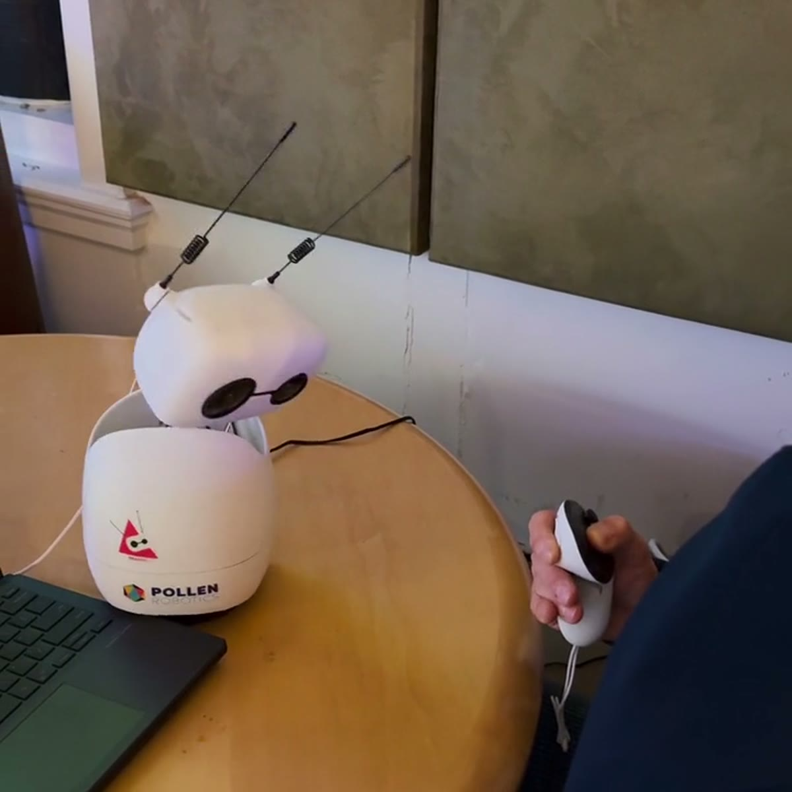
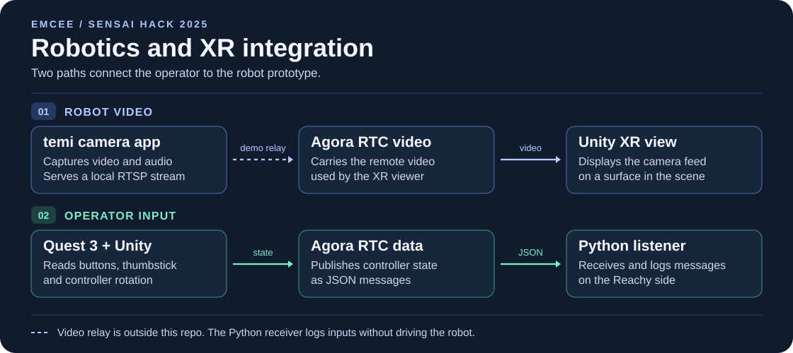

# Bring a small robot into the room.

**Emcee / Sidekick** puts Reachy Mini on a mobile temi and connects the operator through a Quest headset. Built at **SensAI Hack 2025 in San Francisco**, it explores an expressive, remotely operated event host that can meet guests at their level.

*The demo starts at 0:26 with Reachy Mini riding on temi; the headset camera and controller view follows at 0:32. The film's opening standalone rocking experiment belongs to the separate Reachy Mini locomotion project. Emcee is a teleoperated mobile-host prototype.*

[Watch the mobile-host demo](https://vimeo.com/kadiru/demo-reachy-reach#t=26s) · [Team project on Devpost](https://devpost.com/software/700-sf11-vamos-drj9lt)

## Two paths make the interaction possible

**See the room.** The Android app previews temi's camera and serves RTSP video/audio. An external relay bridges the feed to Agora; the Unity viewer displays the remote video in the headset.

**Send operator intent.** Unity samples the controller and sends engagement flags, thumbstick values and orientation as JSON through Agora. The Python listener logs received messages. The sender targets 50 messages per second; this is a configured rate, not a measured latency claim.

This repository demonstrates the camera/controller bridge. The relay and motor-actuation path are outside the receiving listener's scope, so cloning it does not reproduce the whole live robot behavior.

## Follow the implementation

| Component | Start here |
| --- | --- |
| Camera permissions, preview and RTSP | [Android activity](android/app/src/main/java/com/example/temihelloworld/MainActivity.kt) |
| Video display and controller mappings | [Unity C# bridge](unityWin/EmceeXR/Assets/AgoraTemiViewer.cs) |
| Received controller packets | [Reachy-side Python listener](pythonReachy/reachy_teleop_rtc.py) |
| Full prototype, timestamps and setup context | [Integration guide](docs/INTEGRATION_GUIDE.md) |

For a code review, trace a controller field from the Unity sender to the listener. A live exchange requires the same configured Agora channel and the documented external components. The Unity project uses editor **6000.3.0f1**.

## Contribution and next step

**Kadir Uyanik:** robotics and XR integration. **Varun Bhargava:** language models and scripting ideas. **Ryota:** XR, language models and ideation.

The next reproducibility milestone is a documented end-to-end setup with the relay and robot-command adapter, followed by measured video/control latency and disconnect behavior. The existing code preserves the hackathon integration boundary rather than presenting those steps as completed.
