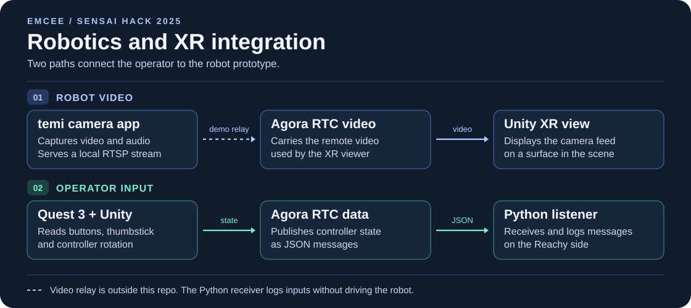

> Preserved project guide from the November 24, 2026 documentation snapshot. Results and test counts below belong to their named experiments and dates. [Project overview](../README.md).

# Emcee | Reachy Mini × temi

Emcee is an XR-operated event host built at SensAI Hack 2025 in San Francisco. Reachy Mini sits on a mobile temi, bringing the expressive robot up to guests. The operator sees the room through temi’s camera and can watch their Quest 3 controller input travel back toward the robots.

[Watch the robotics demo on Vimeo](https://vimeo.com/kadiru/demo-reachy-reach) · [See the team’s project on Devpost](https://devpost.com/software/700-sf11-vamos-drj9lt)

## Follow the demo

| In the video | What to look for | Where to explore |
| --- | --- | --- |
| 0:25 · Mobile platform | Reachy Mini is mounted on temi beside the seated operator. | [Team prototype and hardware](https://devpost.com/software/700-sf11-vamos-drj9lt) |
| 0:32 · Operator view | The headset shows the robot’s camera feed alongside sent and received controller values. | [Unity video and controller bridge](../unityWin/EmceeXR/Assets/AgoraTemiViewer.cs) |
| 1:02 · Guest interaction | Watch the combined robot interact with a participant. | [Robotics demo](https://vimeo.com/kadiru/demo-reachy-reach#t=1m02s) |

## How the operator and robots connect

**Video to the operator.** The [Android app](../android/app/src/main/java/com/example/temihelloworld/MainActivity.kt) previews temi’s camera and serves video and audio over RTSP. A relay outside this repository bridges the feed to Agora. The [Unity viewer](../unityWin/EmceeXR/Assets/AgoraTemiViewer.cs) subscribes to the remote video track and displays it in the headset.

**Input from the operator.** The same Unity script samples the right controller and sends JSON through an Agora data stream. Trigger reports teleoperation engagement, A and B report the temi and Reachy flags, and grip reports the playful-interaction flag. The message also carries thumbstick X/Y and controller pitch, roll, and yaw. The [Reachy-side listener](../pythonReachy/reachy_teleop_rtc.py) logs incoming messages so the team can check delivery. Motor actuation is outside this listener’s scope.

## Find your way around

| To inspect | Start here |
| --- | --- |
| Camera startup, permissions, and streaming on temi | [Kotlin activity](../android/app/src/main/java/com/example/temihelloworld/MainActivity.kt) and [Android project](../android/) |
| The headset view or controller mappings | [Unity project used for the bridge](../unityWin/EmceeXR/), [enabled scene](../unityWin/EmceeXR/Assets/Scenes/SampleScene.unity), and [C# component](../unityWin/EmceeXR/Assets/AgoraTemiViewer.cs) |
| The receiving end of a controller message | [Python listener](../pythonReachy/reachy_teleop_rtc.py) |
| The full event-host concept and the team’s work on dialogue | [SensAI project submission](https://devpost.com/software/700-sf11-vamos-drj9lt) |

The Unity project above uses editor version 6000.3.0f1. The viewer and listener need access to the same Agora channel to exchange messages. The sender defaults to a target of 50 messages per second.

**Team.** Kadir Uyanik worked on robotics and XR integration, Varun Bhargava on language models and scripting ideas, and Ryota on XR, language models, and ideation.
